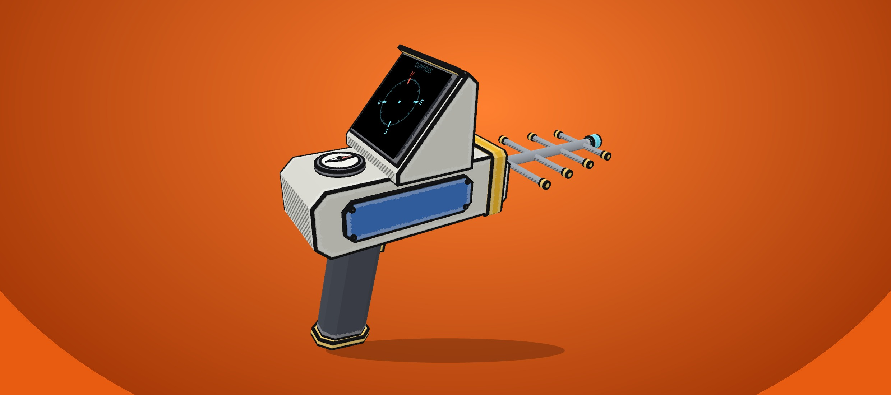

# Handy Beacon Tracker



Need to find a beacon? Track it from your hand.

A handheld Targeting Computer: the same marker, distance and edge arrow, plus a compass that turns as you look.

- Right-click opens the list of beacons and planets, sorted by distance
- The planet you are standing on stays off the list until you leave it
- Pick a target and the game's own marker, name, distance and edge arrow follow it while the tracker is in your hand
- Left-click jumps to the next target
- The screen is a compass: north near a planet, the planet itself farther out, and the nearest asteroid when you are next to one
- Craft it at a ship's Targeting Computer for 10 iron and 4 copper, once that part is researched. Free in a creative world

Every player needs the mod.

MelonLoader mod for Stellar Drive.

## Installation

Install it from the Stellar Mod Manager, or copy `HandyBeaconTracker.dll` from the latest release into the game's `Mods` folder. The game needs MelonLoader.

## Building from source

You need the .NET SDK (any version that can build `net472` projects) and Stellar Drive with MelonLoader installed. The project references the game's own assemblies, so nothing from the game is included in this repository.

```
dotnet build src/HandyBeaconTracker.csproj -c Release -p:GameDir="C:\Program Files (x86)\Steam\steamapps\common\StellarDrive Demo"
```

The DLL ends up in `src/bin/Release`. Add `-p:CopyToMods=true` to copy it into the game's `Mods` folder.

## How the code is organised

| File | What it does |
| --- | --- |
| `HandyBeaconTracker.cs` | Mod entry: registers the item when a world loads |
| `HandyTrackerTool.cs` | The tool in your hand: screen, compass needle, clicks |
| `TrackerGeometry.cs` | The handheld model |
| `TrackerScreen.cs` | The compass card drawn on the screen |
| `TrackerNavigation.cs` | Where north, the planet and the target sit relative to where you look |
| `TargetMenu.cs` | The target list, cloned from the ship's Targeting Computer |
| `TrackerTarget.cs` | The chosen target, and hiding the planet you are standing on |
| `Crafting.cs`, `CraftPanel.cs` | Crafting at the ship's Targeting Computer |
| `TrackerHud.cs` | The game's own marker while the tracker is in your hand |

## License

MIT, see [LICENSE](LICENSE).
